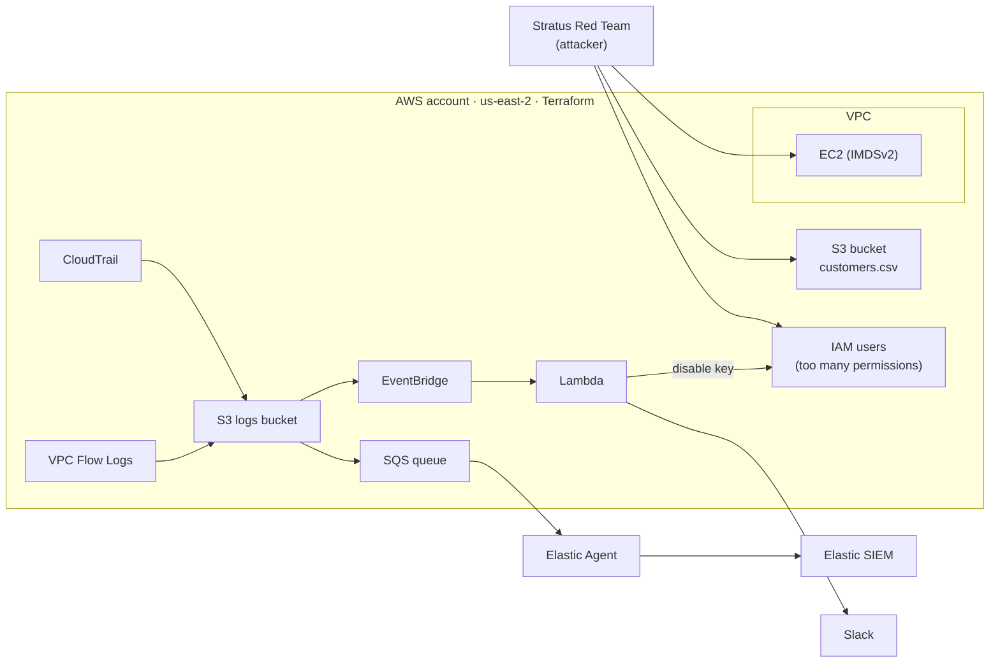
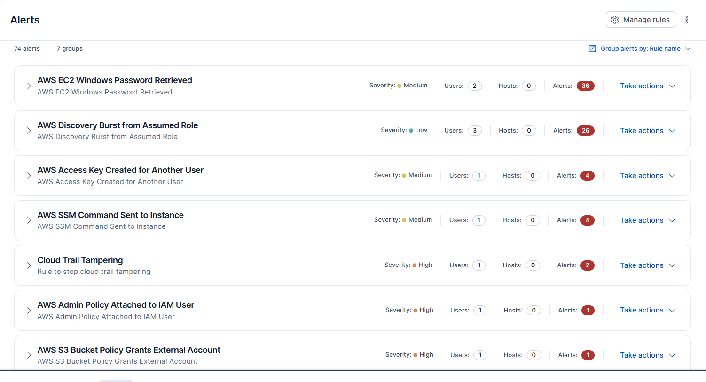
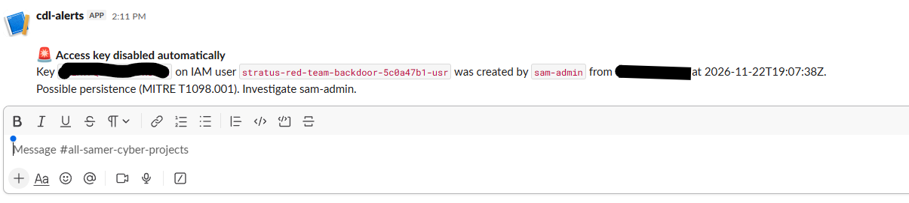

# Cloud Detection & Response Lab
 
I wanted to get hands-on with cloud security, so I built a small, deliberately vulnerable "company" in AWS, attacked it with real cloud attack techniques, wrote detection rules in Elastic to catch the attacks, and set up a Lambda that automatically shuts off a backdoor access key when one gets created.
 
All of the infrastructure is in Terraform, so I can bring the whole thing up with `terraform apply` and tear it down with `terraform destroy`.
 
## How it fits together
 

 
- **The company:** a VPC with one EC2 instance (no inbound access, IMDSv2 on), an S3 bucket with a fake customer list, and two IAM users with way more permissions than they need. One of them can make itself an admin. That's on purpose, it's what the attacks go after.
- **Logging:** CloudTrail across all regions, with S3 data events turned on for the customer bucket (file downloads aren't logged by default), plus VPC Flow Logs. Everything lands in a separate logs bucket.
- **Detection:** when a new CloudTrail file lands, S3 drops a message in an SQS queue. The Elastic Agent picks it up, grabs the file and ships it to Elastic, where my rules run every 5 minutes.
- **Response:** the same new file also triggers EventBridge, which runs a Python Lambda. It reads the file, looks for access keys created for someone other than the person creating them, disables them and posts to Slack.
## Attacks
 
I used [Stratus Red Team](https://github.com/DataDog/stratus-red-team) to run 8 attack techniques, then looked for each one in the logs before writing rules for them.
 
| # | Attack | MITRE ATT&CK | Caught by |
|---|---|---|---|
| 1 | Stop a CloudTrail trail | T1685.002 | CloudTrail Tampering |
| 2 | Create an admin user | T1136.003 | Admin Policy Attached, Access Key for Another User |
| 3 | Add a backdoor key to an existing user | T1098.001 | Access Key for Another User + the Lambda |
| 4 | Open an S3 bucket to an outside account | T1537 | S3 Policy Grants External Account |
| 5 | Delete a CloudTrail trail | T1685.002 | CloudTrail Tampering |
| 6 | Steal EC2 instance credentials | T1552.005 | SSM Command Sent to Instance |
| 7 | Pull EC2 Windows passwords | T1552 | EC2 Password Retrieved |
| 8 | Recon from an instance | T1580 | Discovery Burst, SSM Command Sent |
 
All 8 got caught. My notes on each attack, what gave it away, and the rule tuning are in [docs/attacks.md](docs/attacks.md). The rules are exported in [detections/](detections/).
 

 
*These totals cover all my test runs, including alerts from before I added grouping and suppression to the noisier rules.*
 
## Automated response
 
To test it I ran the backdoor-key attack again and waited. The key was created at 19:07:38 UTC and the Lambda had disabled it by 19:09:24, a bit under 2 minutes later, without me touching anything. It disables the key instead of deleting it so there's still evidence to look at.
 

 
It's slower than it could be. Normally you'd trigger on the IAM event directly through EventBridge in us-east-1 and react in seconds, but my account couldn't use that region (more on that below), so it waits for the CloudTrail log file instead.
 
## Problems I ran into
 
Honestly most of what I learned came from things breaking.
 
- **No GuardDuty.** I was going to compare my rules against GuardDuty, but the AWS Free plan blocks it with a Service Control Policy from the parent organization. Even my admin user gets an explicit deny. So all the detection is my own rules.
- **Locked to one region.** A second SCP blocks us-east-1, which broke my first version of the Lambda since IAM events only go to EventBridge there. I rebuilt it to work off the log files in us-east-2 instead.
- **Noisy rules.** One attack calls `GetPasswordData` 30 times, so my first version of that rule made 30 alerts for one attack. My recon rule also missed the recon at first because I only counted `Describe*` and `List*` calls and the attack used a lot of `Get*` calls. And Stratus's own setup steps looked like attack 4, so I had to make that rule check for an outside account instead of alerting on every bucket policy change.
- **I almost pushed a secret.** I put my Slack webhook URL straight into `variables.tf` and GitHub's push protection blocked the push. I squashed it out of my history, rotated the webhook, and now it only gets passed in as an environment variable.
- **A cleanup that won't finish.** The same SCP blocks deleting IAM login profiles, so one of Stratus's test users is stuck in my account. It has no keys or permissions, so it can't do anything.
## If I kept going
 
- Send the VPC Flow Logs into Elastic too, so I can catch network stuff like port scans
- Automate more responses, like turning CloudTrail back on if someone stops it
- Move the Lambda to the real-time EventBridge trigger in an account without the region lock
## Running it
 
You need an AWS account, the AWS CLI and Terraform. Elastic, Slack and Stratus are optional.
 
```bash
cd terraform
export TF_VAR_slack_webhook_url='https://hooks.slack.com/services/...'   # optional
terraform init
terraform apply
```
 
To hook up Elastic, add the AWS CloudTrail integration, point it at the SQS queue (`terraform output cloudtrail_queue_url`) and give it a key for the `cdl-elastic-reader` user, which can only read the logs. Then import the rules from `detections/`.
 
Running an attack:
 
```bash
export AWS_REGION=us-east-2
stratus detonate aws.persistence.iam-backdoor-user
stratus cleanup aws.persistence.iam-backdoor-user
```
 
Don't forget `terraform destroy` when you're done. The EC2 instance costs money while it's running.
 
## Built with
 
AWS (EC2, S3, IAM, CloudTrail, VPC Flow Logs, SQS, EventBridge, Lambda), Terraform, Elastic SIEM, Stratus Red Team, Python, Slack
 
